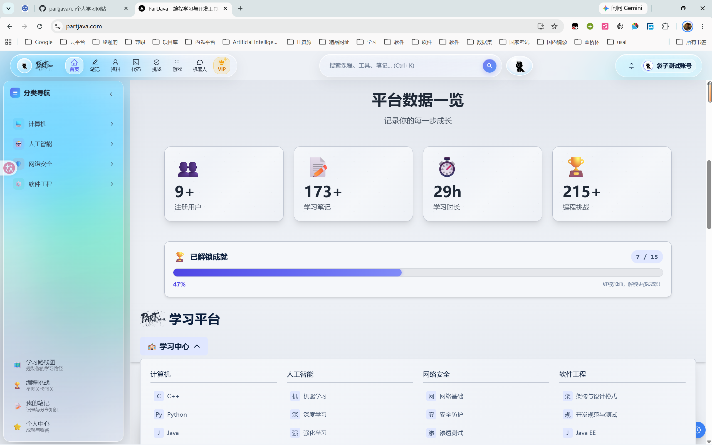

# PartJava 智能学习平台



**个人学习项目，仅供学习参考，禁止商业用途**

| 项目 | 状态 |
|------|------|
| 在线地址 | [https://www.partjava.com](https://www.partjava.com) |
| 评审测试账号 | `example@qq.com` / `123456` |
| 部署状态 | ✅ 生产环境运行中 |
| HTTPS | ✅ Let's Encrypt SSL |
| 服务器 | Linux + Nginx + PM2 |
| 数据库 | MySQL 8.0 + Redis |
| 后端 | Java 21 + Spring Boot 3.3 |

---

## 🌟 项目亮点

- **🤖 Function Calling AI Agent**：3D 黑猫「禾桔」由 plan → act → observe 自主决策循环驱动，站内领航 / 联网深搜 / 自动写笔记 / 3D 神态控制四大工具由 LLM 自主调度，执行轨迹实时可视化
- **🔍 端云协同 RAG**：509 个课程页向量化（4096 维特征哈希 TF-IDF）构建检索索引，混合打分（0.6×余弦 + 0.4×标题词面），Next.js 与 Python 双端共享同一向量空间
- **🔌 MCP 协议支持**：四大 AI 工具同时以 MCP 标准 Server 暴露（`partjava-ai/mcp_server.py`），可被 Claude Desktop / Cursor 等任意 MCP 客户端挂载
- **🎙️ 多模态交互**：Web Speech API 语音输入 + TTS 朗读；Transformers.js 浏览器端语义缓存（相似问题离线秒回）
- **💻 在线代码执行**：Judge0 CE + Spring Boot 代理，支持 10 种语言沙箱运行
- **🐾 3D 算法可视化**：覆盖 21 种算法的 Three.js 3D 动态演示
- **🏆 成就徽章系统**：15 个成就，数据驱动自动解锁
- **📈 数据可视化大屏**：ECharts 实时统计 + 学习热力图
- **🎨 中国水墨画 UI**：纯 SVG 山水/云雾/墨竹/飞鸟装饰
- **🔐 多层安全防护**：密钥全环境变量化 + 速率限制 + HTTP 安全头 + 输入校验 + 优雅降级

---

## 主要功能

### 1. Function Calling 多智能体助手（3D 黑猫「禾桔」）

全站右下角悬浮的 3D 像素黑猫，由 `partjava-ai`（Python FastAPI）与 Next.js 内置 Agent 引擎双层驱动：
- **自主决策**：LLM 通过 Function Calling 自主决定调用哪些工具、什么参数，最多 4 轮工具循环
- **四大工具**：站内课程 RAG 检索 / 联网权威检索与正文抓取 / 结构化笔记提炼 / 3D 猫神态控制
- **执行轨迹可视化**：每一步 plan（💭）→ act（⚡）→ observe（✓）实时展示在前端面板
- **三级降级**：FastAPI 服务 → Next.js 内置引擎 → 离线本地智能回复（UI 明确标注「离线降级模式」）

### 2. 端云协同 RAG 知识检索

- **索引构建**：`node scripts/build-rag-index.mjs` 扫描 509 个课程页，抽取文本 → 中文 bigram + 英文词分词 → FNV-1a 特征哈希到 4096 维 → TF-IDF 加权归一化
- **混合检索**：0.6 × 向量余弦 + 0.4 × 标题词面匹配，低置信自动回落关键词层
- **端侧语义缓存**：浏览器内 Transformers.js（multilingual-e5-small）对问答对做语义匹配，命中即离线秒回

### 3. MCP 标准工具服务

```bash
cd partjava-ai && python mcp_server.py   # stdio 传输的 MCP Server
```
暴露 `search_site_pages` / `web_search` / `draft_note` / `set_companion_state` 四个工具，配置到任意 MCP 客户端即可调用。

### 4. 在线代码执行

基于 Monaco Editor（VS Code 同款内核），Spring Boot 后端代理 Judge0 CE 云端执行引擎，支持 Python、JavaScript、Java、C++、Go 等 10 种语言。

### 5. 智能笔记系统

三级分类 + 多标签管理，Markdown 编辑、公开/私有设置、实时搜索、收藏评论；AI 一键把当前页面/对话提炼为结构化笔记草稿。

### 6. 编程挑战宇宙

11 个阶段、星图关卡，包含选择题、代码题、AI 评分的思考题，排行榜系统激励学习。

### 7. 其他

成就徽章系统（15 个）、四大学科图文学习内容（进度追踪）、ECharts 数据大屏、学习热力图、移动端手势 + PWA + 触觉反馈。

---

## 技术栈

### 前端
- **框架**：Next.js 14 (App Router) + React 18 + TypeScript（strict 模式）
- **UI**：Ant Design 5.x + Tailwind CSS 3.x
- **3D**：Three.js + WebGL（懒加载，不拖累首屏）
- **AI 交互**：SSE 流式渲染、Function Calling 执行轨迹面板、Web Speech 语音输入/朗读
- **端侧 AI**：Transformers.js（multilingual-e5-small 语义缓存）
- **代码编辑器**：Monaco Editor
- **可视化**：ECharts + D3.js

### 后端
- **主后端**：Java 21 + Spring Boot 3.3 + MyBatis-Plus + Spring Security (JWT)
- **AI 服务**：Python FastAPI 多智能体（`partjava-ai/`），与 Next.js 内置引擎互为冗余
- **数据库**：MySQL 8.0（25 张表）+ Redis 7

### 部署
- **Web 服务器**：Nginx 反向代理 + Let's Encrypt SSL 自动续期
- **进程管理**：PM2（配置模板见 `ecosystem.config.example.js`，真实配置在私有数据仓）

---

## 项目结构

```
partjava/
├── app/                          # Next.js 前端
│   ├── admin/                    # 管理后台
│   ├── api/ai/agent/stream/      # AI Agent SSE 流式接口
│   │   ├── route.ts              #   Agent 循环（FastAPI 代理 + 内置引擎双链路）
│   │   └── lib.ts                #   纯逻辑层：RAG 检索/工具 schema/工具执行器（含单测）
│   ├── challenges/               # 编程挑战宇宙
│   ├── code/                     # 在线代码编辑器
│   ├── notes/                    # 智能笔记系统
│   ├── study/                    # 四大学科学习内容（509 页）
│   ├── _shared/lib/edge-ai.ts    # Transformers.js 端侧语义缓存
│   ├── _shared/data/rag-index.json  # RAG 向量索引（构建产物，可重建）
│   └── _shared/components/       # 全局组件（AI3DRobot 3D 黑猫等）
├── partjava-ai/                  # Python 多智能体服务
│   ├── agents/                   #   router(调度循环) / navigator / notewriter / websearch / companion / rag_index
│   ├── mcp_server.py             #   MCP 标准 Server（stdio）
│   └── main.py                   #   FastAPI 入口（:8000）
├── partjava-backend/             # Spring Boot 后端
│   └── src/main/java/com/partjava/
│       ├── controller/           # REST API
│       ├── service/              # 业务逻辑
│       ├── common/utils/JwtUtils # JWT（密钥仅环境变量注入）
│       └── config/               # Security / Redis / MyBatis
├── scripts/
│   ├── schema.sql                # 脱敏建表语句（25 张表，无数据）
│   └── build-rag-index.mjs       # RAG 索引构建脚本
├── ecosystem.config.example.js   # PM2 配置模板
└── docs/                         # 设计文档
```

---

## 安装与运行

### 前提条件
- **Node.js** 18+（建议 20）
- **JDK** 21+、**Maven** 3.8+
- **MySQL** 8.0+、**Redis** 7.x
- （可选）Python 3.10+ —— 启动 FastAPI 智能体服务

### 1. 克隆仓库
```bash
git clone https://github.com/partjava/i.git
cd i
```

### 2. 初始化数据库
```bash
mysql -u root -p -e "CREATE DATABASE partjava_notes DEFAULT CHARACTER SET utf8mb4"
mysql -u root -p partjava_notes < scripts/schema.sql
```

### 3. 启动后端（Spring Boot）
```bash
cd partjava-backend
DB_USER=root DB_PASSWORD=你的密码 JWT_SECRET=一个至少32字节的随机串 mvn spring-boot:run
```
后端默认运行在 `http://localhost:8080`。
> `JWT_SECRET` 未配置时也能启动（自动生成一次性随机密钥），但重启后登录态失效；生产环境必须显式配置。

### 4. 启动前端（Next.js）
```bash
# 新开终端，回到仓库根目录
npm install
cp .env.example .env.local   # 填入 DEEPSEEK_API_KEY 等
npm run dev
```
前端默认运行在 `http://localhost:3000`。

### 5. （可选）启动 Python 智能体服务
```bash
cd partjava-ai
pip install -r requirements.txt
python main.py               # FastAPI :8000
# 或 MCP Server：python mcp_server.py
```
> 未启动时前端自动走 Next.js 内置 Agent 引擎，功能完整等价（双层冗余设计）。

### 6. （可选）重建 RAG 索引
```bash
node scripts/build-rag-index.mjs
```
> 仓库已附带构建好的 `app/_shared/data/rag-index.json`，仅在课程内容变更后需要重建。

### 环境变量

完整模板见 [`.env.example`](.env.example)：数据库、`JWT_SECRET`、`DEEPSEEK_API_KEY`、`FASTAPI_AGENT_URL`、`JUDGE0_API_KEY` 等。
**所有密钥仅通过环境变量注入，源码与仓库中不含任何真实密钥。**

---

## 测试

```bash
# 后端（JUnit 5）：JWT 签发/篡改拒绝/过期判定/随机密钥兜底
cd partjava-backend && mvn test

# 前端（Vitest）：RAG 检索相关性 / 工具参数容错解析 / 站内关键词检索
npm test
```

---

## API 架构

前端通过 Next.js Rewrites 将 `/api/*` 请求透明代理到 Spring Boot 后端（`localhost:8080`）；`/api/ai/agent/stream` 优先转发 FastAPI（`:8000`），失败时由内置 Agent 引擎接管。

完整接口文档见 [docs/backend-api.md](docs/backend-api.md)。

---

## 许可说明

**本项目为个人学习项目，仅供学习和参考使用。未经作者明确许可，禁止用于商业目的。**

Copyright © 2024-2026 PartJava
