# 禾桔书房 · AI 伴学平台（PartJava）

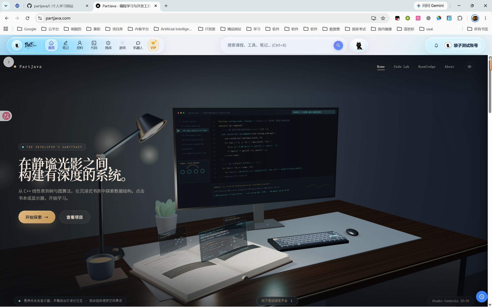

> **2026 传智杯 · AI Web 网页开发挑战赛参赛作品** —— AI Native 伴学平台：3D AI 伴侣「禾桔」以 Function Calling Agent 驱动站内 RAG 检索、联网深搜、笔记提炼与 3D 神态控制。

## 团队信息

| 项目 | 内容 |
|------|------|
| 团队名称 | **Syntora** |
| 队长 | 贺思涵 |
| 组员 | 宋维维、周子轩 |
| 所属院校 | 武汉晴川学院 |
| 参赛编号 | 1952552 |

## 项目信息

| 项目 | 内容 |
|------|------|
| 在线地址 | [https://www.partjava.com](https://www.partjava.com) |
| 评审测试账号 | `example@qq.com` / `123456` |
| 前端 | Next.js 14（App Router）· React 18 · TypeScript · Tailwind CSS · Ant Design |
| 后端 | Java 21 · Spring Boot 3.3 · MySQL 8 · Redis |
| AI 服务 | Python FastAPI · deepseek-flash / deepseek-v4-pro · MCP 协议 |

---

## 📌 Git 提交历史与版本演进说明

> [!IMPORTANT]
> **【特别说明 · 评审专家审阅】**  
> 本代码仓库保留了完整、真实的 Git 提交历史。其中：
> - **2026年6月21日（提交 `b2c5183`：`feat: SQL和计算机组成原理转换完毕，使用书本翻页模板`）** 为本届 **2026 传智杯 · 全国高校 AI Web 开发挑战赛** 的**全量推倒重构起点**。
> - **2026年6月21日 至今的 80+ 次规范提交**，完整忠实地呈现了本届作品的全部核心自研与推倒重构历程：
>   1. **全站 UI 范式重塑**：自研拟真双页书籍排版系统（LessonLayout + BookSpread）与 Canvas 命令栈截图标注画板，升级全栈知识星系拓扑图谱与关卡路线；
>   2. **后端全量推倒重写**：从旧版 Node.js 彻底推倒重构，改用 **Java 21 LTS + Spring Boot 3.3.1 + MyBatis-Plus + Redis 7.x** 企业级经典分层架构；
>   3. **AI Native 核心伴侣**：构建原生 WebGL/GLSL 顶点着色器 3D 黑猫「禾桔」、自主决策智能体循环（Plan → Act → Observe）与静态轻量 RAG；
>   4. **全域灵宠守护体系**：书房 3D 漫游、个人中心「安全守卫」互动舞台（眼神跟随）、登录/注册密码遮眼拟人情境互动；
>   5. **素白现代算法与代码工坊**：三位一体（3D几何-数据变迁-代码高亮）联动播放器、Atom One 语法高亮主题、安全沙箱代理与服务端权威防作弊游戏；
> - 2026年6月21日之前的早期提交为上一届参赛原型的历史探索记录。评审专家在仓库根目录下执行 `git log`，即可直接复现本届比赛完整、真实、连续的代码演进轨迹。

---

## 🌟 项目亮点

- **🤖 Function Calling AI Agent**：3D 黑猫「禾桔」由 plan → act → observe 自主决策循环驱动，站内领航 / 联网深搜 / 自动写笔记 / 3D 神态控制四大工具由 LLM 自主调度，执行轨迹实时透明可视化
- **🔍 端云协同轻量静态 RAG**：全站课程页向量化（特征哈希 TF-IDF）构建轻量索引，混合打分（余弦 + 标题词面），Next.js 与 Python 双端跨语言哈希空间一致，零外部向量数据库运维成本
- **🔌 原生支持 MCP 行业标准**：四大核心工具以标准 stdio 协议封装为 MCP Server（`partjava-ai/mcp_server.py`），可直接被 Claude Desktop / Cursor 等外部 AI 终端挂载使用
- **📖 拟真双页书籍与全栈知识星系图谱**：自研 Book-style UI 典籍双页排版，结合 360 度径向树全栈知识拓扑与线性进阶闯关路线，打通宏观脉络导览与微观精读闭环
- **🐾 全域 3D 灵宠伴侣交互**：GLSL 顶点着色器驱动 3D 黑猫「禾桔」，覆盖书房伴学、个人中心「安全守卫」互动舞台（全屏鼠标视差跟随）与登录鉴权密码遮眼情境互动
- **💻 质感素白算法可视化与代码工坊**：首创“3D几何形态 - 步骤状态机 - C++20/Java代码高亮行”三位一体同步演进播放器，Monaco Editor 定制 Atom One 现代语法高亮体系
- **📊 个人中心量化成长大屏**：智能双态学习时长卡片（小时/分钟秒切与4秒自动复位）、2026 全年 365 天打卡热力图（点击弹出单日明细）、近 60 天时长/笔记双轴协同成长图与知识收藏专区穿透
- **🎮 服务端权威防作弊游戏**：全新质感浅色科技点阵设计（Light-themed Arcade UI），纯 Java 服务端状态机按 tick 演进与 step 校验，根绝客户端内存篡改
- **🎨 东方水墨科技美学**：纯 SVG 山水、云雾、墨竹、朱红印章装饰贯穿全站，文化底蕴与现代交互深度融合
- **🔐 企业级安全与双引擎容灾**：Next.js 与 Python FastAPI 双引擎无感热切 + 离线兜底，密钥全环境变量物理隔离治理

---

## 主要功能

### 1. 沉浸式 3D 数字开屏书房（Sanctuary）

独立 WebGL 应用以 iframe 优雅嵌入主站，通过专属三通道 `postMessage` 协议实现外层滚轮无缝穿透、平滑滚动引导，并在滚出视口后由 `IntersectionObserver` 自动挂起渲染循环，释放 GPU 算力：


### 2. 拟人化鉴权与全域灵宠伴学（登录与注册）

在用户进入平台的第一时间建立温暖的情感连接：
- 表单顶部常驻自研 `EyePet` 互动灵宠，实时跟随鼠标 NDC 视差调整眼球凝视方向；
- 用户输入密码时，黑猫自动触发“害羞捂眼”趣味动画；校验异常时表现出关切微表情，将枯燥凭据输入升华为有温度的情感交互。

| 平台登录界面 | 平台注册界面 |
| :---: | :---: |
| 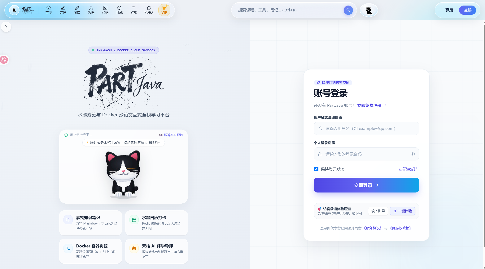 | 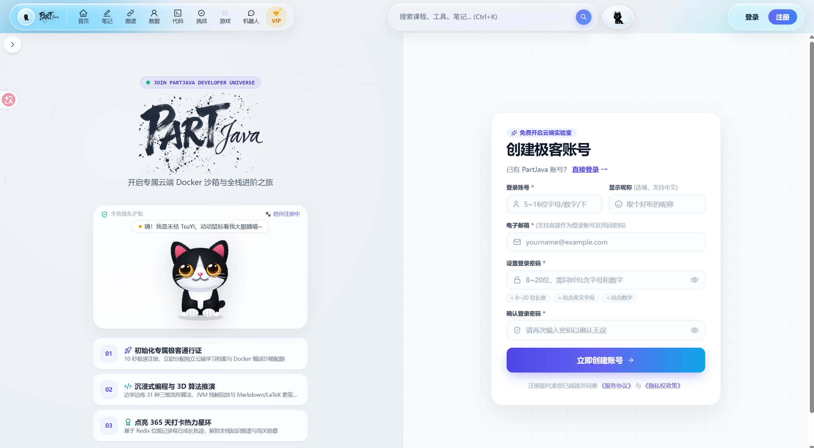 |

### 3. 拟真双页书籍阅读与全栈知识星系图谱

进入任意技术领域课程，彻底颠覆传统向下滑动的长网页模式，创新自研 **Book-style UI** 典籍阅读与 **全栈知识拓扑** 双重視角导览：
- **拟真双页书籍阅读器**：开卷典籍对称排版、拟真页码（如「— 1 —」、「— 2 —」）、翻页微动效、实时章节大纲、嵌入式 AI 伴学助手与 Canvas 命令栈截图标注画板；
- **全栈知识星系拓扑图谱**：基于 360 度径向树（Radial Tree）与力导向关系算法，覆盖 15 大核心技术领域，防重叠折叠交互，支持宏观脉络与双页书籍微观精读一键直达；
- **全栈进阶闯关路线**：以游戏化通关流线串联基础筑基到高阶架构的技术攀登路线，右侧联动搭载“节点深度透视舱”。

| 沉浸式双页书籍翻页学习界面 | 全栈课程知识库卡片导览系统 |
| :---: | :---: |
| 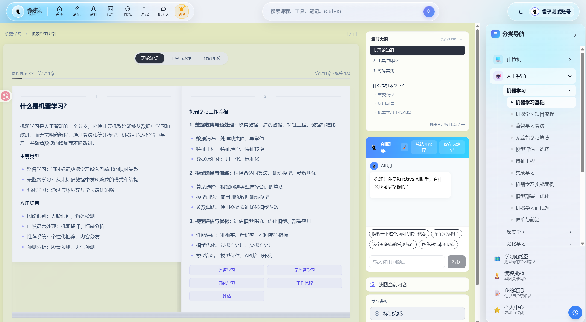 | 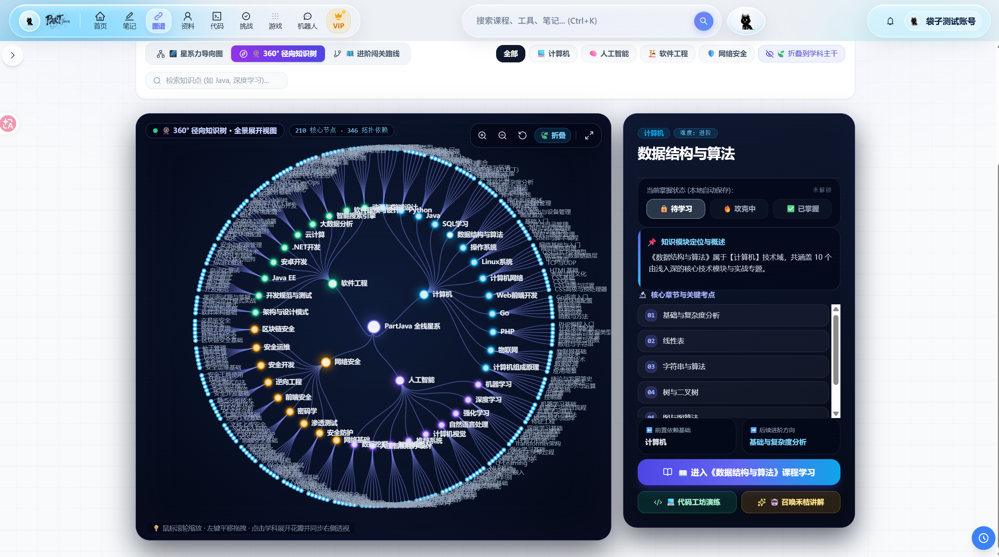 |

| 全栈知识星系拓扑图谱 | 全栈进阶闯关路线与节点透视舱 |
| :---: | :---: |
| 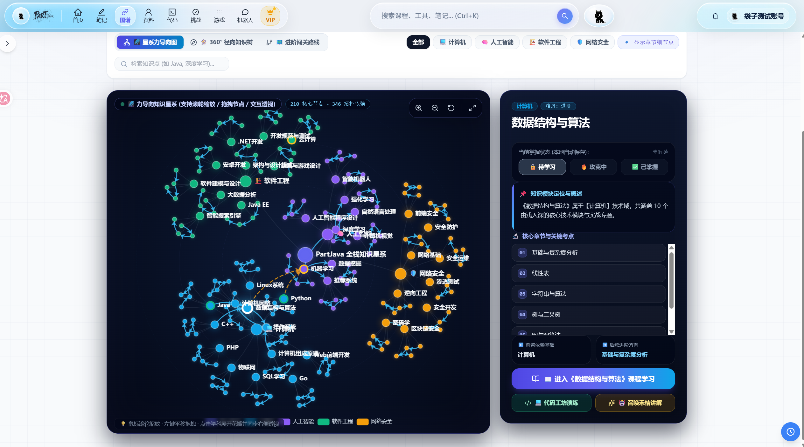 | 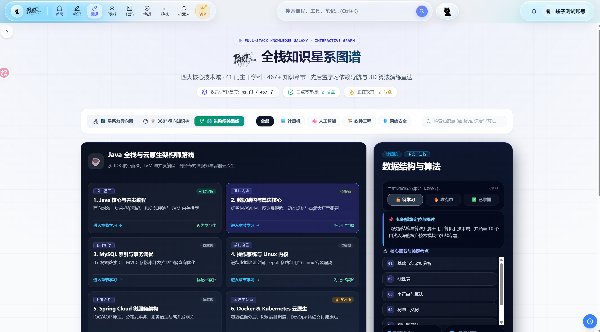 |

### 4. 3D AI 伴侣「禾桔」与 Function Calling 决策闭环

全站常驻 3D 黑猫伴侣「禾桔」，双引擎驱动（Python FastAPI + Next.js 内置引擎互为热备）：
- **自主决策**：LLM 通过 Function Calling 自主决定调用四大工具（站内 RAG 课程检索、联网深搜、写笔记、猫神态控制），循环执行直到信息充分；
- **透明执行轨迹**：每一步 `Plan（💭）→ Act（⚡）→ Observe（✓）` 实时流式呈现在面板上，课程胶囊可一键直达，联网深搜提供带编号的权威引证卡片；
- **三维空间投影思维气泡**：利用 Three.js 的 `Vector3.project(camera)` 数学转换，实时将 3D 猫嘴部的世界坐标映射为屏幕 2D 像素坐标，动态锚定思维气泡。

| AI 书房 3D 数字空间全景 | 深度流式对话交互与透明执行轨迹 |
| :---: | :---: |
| 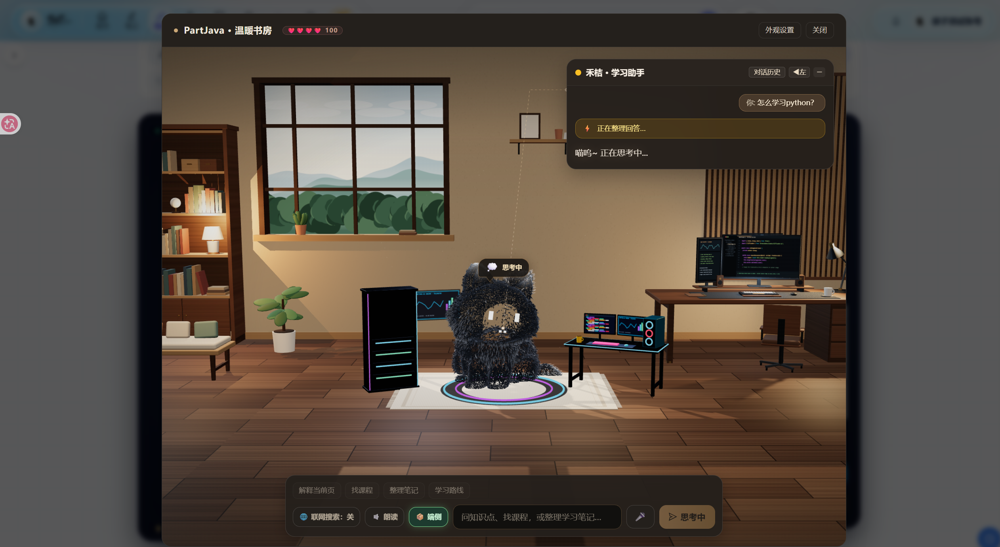 | 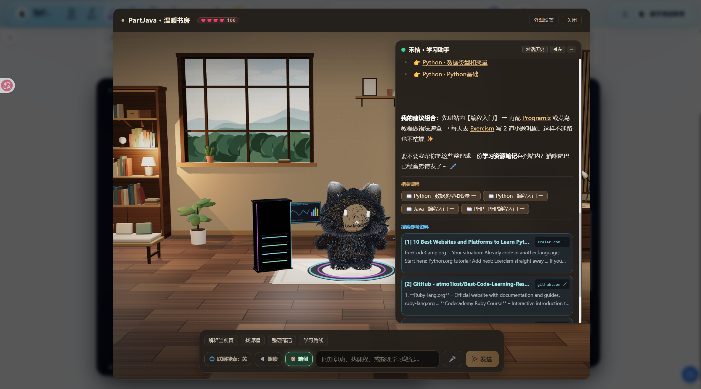 |

### 5. 3D 算法可视化实验室（质感素白现代 UI）

系统全面升级为东方水墨素白现代轻量 UI，彻底消除深色视觉疲劳：
- **三位一体联动播放器**：首创“3D几何形态 - 步骤状态机 - C++20/Java代码高亮行”三位一体联动同步演进播放器，推演时光标实时跟随跳动，支持单步自动播放、暂停与变速；
- **KaTeX 高清数学公式无缝排布**：深度集成 KaTeX 公式渲染引擎自适应分句排布，去除公式框横纵滚动条阻碍；深入覆盖 3-6-4-2 深度神经网络前向传播、高维参数曲面与经典算法栈帧回放。

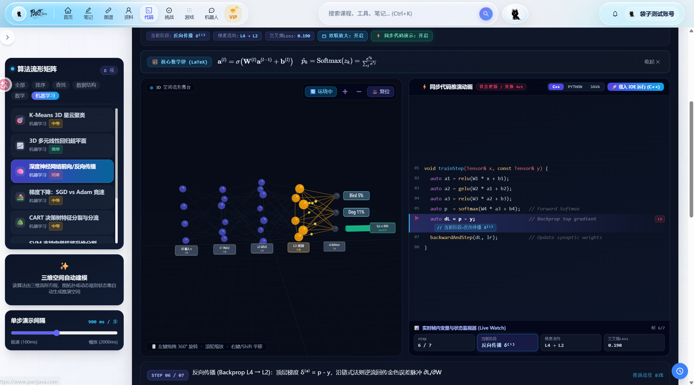

### 6. 在线多语言编程代码工坊

- **素白通透界面与 Atom One 语法高亮**：基于 Monaco Editor 深度定制 Atom One 现代语法高亮主题，符号、关键字、字符串对比鲜明舒适；
- **多语言与算法模板**：内置常用算法骨架模板；Spring Boot 异步代理 Judge0 CE 隔离容器，秒级返回 stdout、运行时内存占用与耗时，沙箱报错一键直达 AI 诊断。

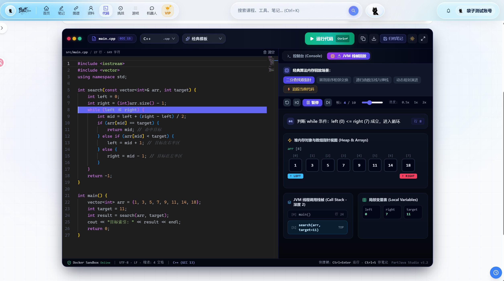

### 7. 智能笔记管理系统与 AI 一键提炼

- **右侧常驻浮动目录树（Sticky TOC）**：长文本详情页右侧常驻目录导航树，页面垂直滚动时锁定视口，支持平滑锚定与高亮跟随；
- **Atom One 高亮与思维导图**：代码块融合 Atom One 渲染，支持 KaTeX 原生公式与思维导图（Mind Map）视图切换；
- **AI 对话一键提炼入库**：对话中 Agent 可通过 `draft_note` 工具直接将探讨精华整理为规范 Markdown 笔记草稿存库，Canvas 画板一键导出标注重点长图。

| 智能笔记详情界面（Sticky TOC） | 智能笔记分类与标签管理 |
| :---: | :---: |
| 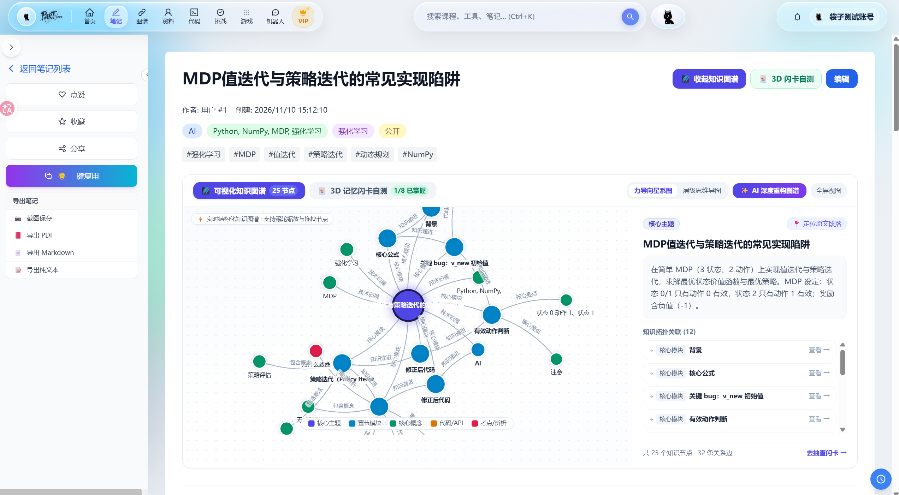 | 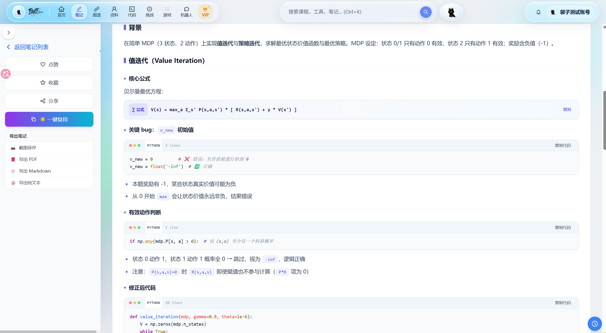 |

### 8. 编程挑战星图宇宙与 AI 导师判卷

- **星图关卡**：粒子星空星图呈现关卡地图与天梯排行榜；
- **AI 导师智能判卷**：思考题由后端调度专属大模型 Prompt 充当 AI 导师进行结构化审阅，毫秒级输出 0~100 分数、采分点掌握度分析及针对性改进评语。

| 编程挑战星图关卡系统 | AI 导师智能判卷与批注 |
| :---: | :---: |
| 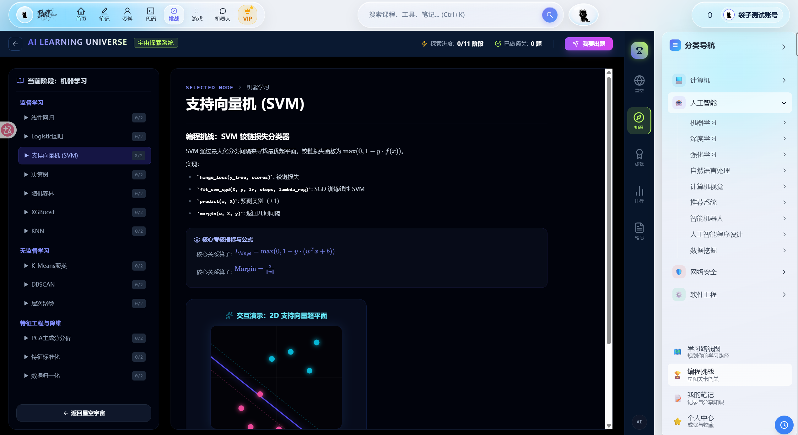 | 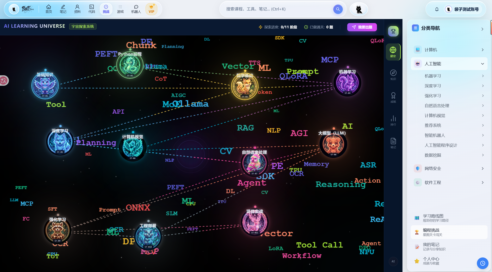 |

### 9. 个人中心量化成长大屏与我的收藏专区

个人中心融合拟人化情感陪伴与量化学习追踪：
- **常驻 3D 萌宠「禾桔 TsuYi」互动舞台**：带有“禾桔安全守卫中”认证盾牌，眼神实时跟随鼠标 NDC 视差注视；
- **智能双态切换学习时长卡片**：默认显示易读的“X小时X分”，点击卡片秒切为纯“X分钟”精确统计，并在 4 秒无操作后自动渐变复位；
- **2026 全年 365 天打卡热力图**：点击任意方块精准弹出当日打卡次数与当日累计学习时长明细；
- **近 60 天学习时长与笔记篇数双轴趋势图**：ECharts 双轴混合图呈现理论输入与笔记沉淀的协同演进；
- **我的收藏专区穿透**：右侧卡片一键穿透直达“我的收藏”知识资产库，支持按技术分类筛选与温故知新。

| 个人中心成长大屏 | 我的收藏知识沉淀专区 |
| :---: | :---: |
| 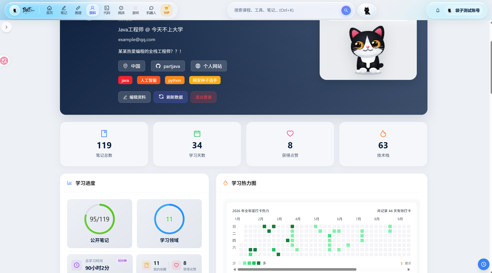 | 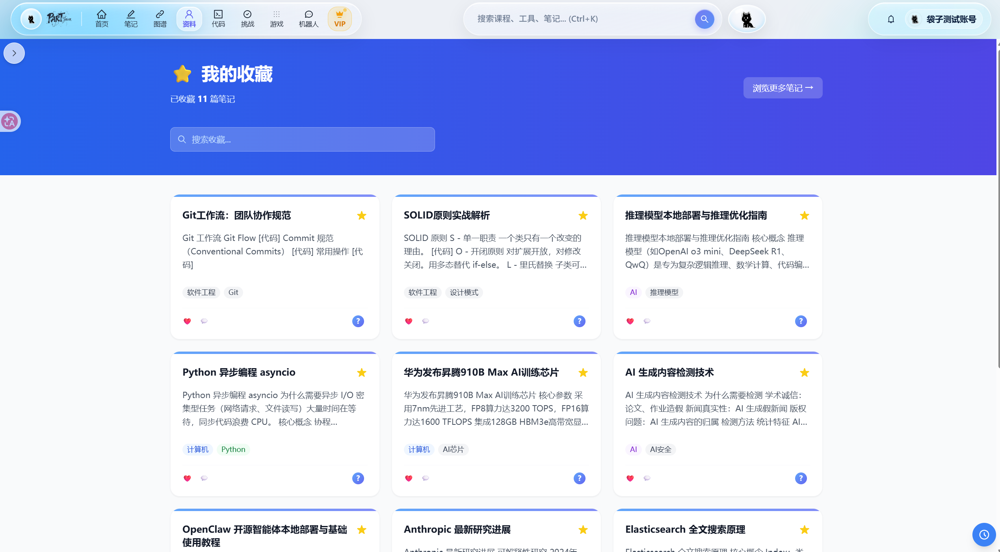 |

### 10. 学习小游戏中心（服务端权威防作弊架构）

游戏中心全面重构为**质感浅色科技微光与像素点阵设计（Light-themed Arcade UI）**，涵盖算法消消乐、语法跑酷、进制转换对战等多款趣味益智街机：
- **服务端权威架构**：游戏核心状态机运行于服务端 `GameEngine` 之上，实时类按 tick 演进并经 SSE 逐帧下发绝对坐标状态，回合类按步计算校验；
- **架构收益**：前端 Canvas 只负责轻量渲染，配合本地物理模块处理平滑手感，从架构根源彻底杜绝客户端作弊篡改。

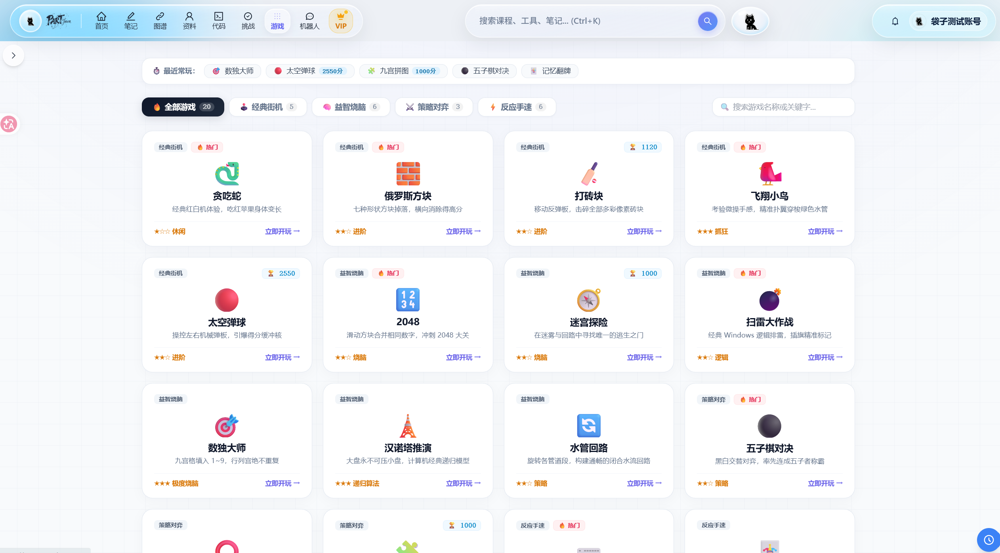

---

## 技术架构

### 总体架构

```
浏览器
 ├─ Next.js 前端（App Router · React 18 · TypeScript strict）
 │   ├─ AI 书房：Three.js WebGL 渲染 + SSE 流式对话 + Web Speech 语音
 │   ├─ Sanctuary 开屏：iframe 嵌入独立 WebGL 单页应用
 │   └─ middleware：按 IP + 路径的内存限流、HTTPS 跳转
 ├─ Next.js API 层
 │   ├─ Agent 引擎：Function Calling 循环 + RAG 检索（SSE 输出）
 │   └─ /api/* 透明代理 → Spring Boot
 ├─ Python FastAPI Agent 服务（与内置引擎同构互备）+ MCP Server
 └─ Spring Boot 后端（业务 + JWT 安全 + 服务端权威游戏引擎）
      ├─ MySQL 8 / Redis
      └─ DeepSeek API · Judge0 代码沙箱
```

### 页面与模块的实现方式

#### 首页与 Sanctuary 开屏

- **独立 WebGL 应用**：开屏是 `public/sanctuary/` 下的单页应用，按场景 / 音频 / 全息书 / 桌面配饰 / 导演控制器模块化组织，iframe 嵌入首页
- **postMessage 通信**：滚轮事件穿透到外层滚动容器；`IntersectionObserver` 检测滚出视口后通知内层暂停渲染、释放 GPU
- **容错设计**：统计卡接口失败自动隐藏
- **桌面隐喻导航**：工具导航做成可拖拽调整宽度与内容密度的「桌面文件夹」舞台
- **程序化水墨**：SVG 生成的山水 / 云雾 / 墨竹 / 飞鸟贯穿页首页尾

#### 学习内容（四大领域课程体系）

- **数据驱动课程**：内容以结构化数据常量描述，由书籍 UI 体系（封面 / 翻页 / 正文版式 / 主题令牌）统一渲染——新增课程只需加数据、无需写布局
- **时长可靠上报**：学习追踪器定时轮询上报，页面关闭用 `sendBeacon` 兜底，时长不丢失
- **截图标注编辑器**：html2canvas 采集 + **Canvas 命令栈**模式——每步操作是栈上的命令对象，撤销 / 重做是栈操作的天然结果；画笔 / 图形 / 文字 / 剪贴板粘贴皆为实现该接口的命令

#### AI 书房（3D 伴侣「禾桔」）

- **原生 Three.js**：不依赖 react-three-fiber；受限 OrbitControls + ACES 色调映射 + 双侧轮廓光摄影棚布光
- **shader 级动画**：呼吸 / 转头 / 动耳 / 摇尾全部在**顶点着色器**按蒙皮权重变形完成；绒毛簇是 InstancedMesh，材质注入同一套变形——毛根与身体逐顶点同步、毛向随旋转矩阵转动
- **灯光情绪**：灯光颜色 / 强度 / 曝光作为情绪参数，随对话状态（思考 / 联网 / 发言 / 庆祝）逐帧插值
- **灵气系统**：注意力状态机（输入看输入框、语音侧耳、久无操作打瞌睡）、空闲微动作导演、射线检测摸猫分区、localStorage 亲密度记忆（影响行为并注入对话上下文）
- **过程可视化**：SSE 流式渲染；执行轨迹面板 + 嘴部三维坐标实时投影定位的思维气泡

#### 3D 算法可视化实验室（`visualizer/` 插件体系）

- **执行 / 渲染解耦**：每个算法 = 两个纯函数——`generateSteps` 预生成步骤序列（数据），`render` 渲染单步到 THREE.Group（视图）
- **场景托管**：`SceneManager` 管理场景 / 光照 / 阴影 / 相机生命周期；HUD 徽章与光效用 Canvas 纹理精灵缓存
- **播放即游标**：步进 / 暂停 / 变速只是步骤数组上的游标操作
- **领域模块**：排序查找 / 数据结构（AVL、BST、图遍历、动态规划）/ 数学参数曲面（Mandelbrot、Lorenz、环面、Klein 瓶）/ 机器学习（K-Means、梯度下降、神经网络、决策树、SVM、PCA、Transformer），嵌入代码沙箱页边学边验证

#### 编程挑战宇宙

- **星图渲染**：DOM 变换布局的关卡地图 + 两层 Canvas 粒子星空 / 星尘
- **内容与视图分离**：题目体系为结构化数据文件；渲染层含知识树、测验工作台、Monaco 面板、AI 导师侧栏、SVM 等可视化组件
- **AI 评分**：思考题由后端按题目自带评分 Prompt 调用大模型，输出结构化分数与评语；公式经 remark-math / rehype-katex 渲染

#### 在线代码沙箱

- **链路**：Monaco 受控组件 → Spring Boot 代理 Judge0 CE（异步轮询 + Base64 解码）→ stdout / 耗时 / 内存

#### 笔记系统

- **三段式**：列表 / 详情 / 编辑，ReactMarkdown 全程渲染，三级分类 + 多标签
- **AI 闭环**：模型产出标题 / 分类 / 标签（多层 JSON 容错解析）→ 预览微调 → 一键入库，「学 → 问 → 记」最短路径

#### 个人中心与数据可视化

- **可视化**：ECharts 学习热力图（类 GitHub 贡献图）+ 折线 / 饼 / 雷达多维统计
- **事件驱动成就**：用户行为发布为 Spring 事件，监听器判定解锁并落库，前端只消费结果

#### 游戏中心（服务端权威架构）

- **逻辑在服务端**：`GameEngine` 基类派生实时 / 回合制引擎——实时类按 tick 演进并经 SSE 逐帧下发，回合类按步计算校验
- **前端只管渲染**：Canvas 渲染 + 输入采集，配 TypeScript 物理模块处理本地手感
- **架构收益**：天然防作弊；同一引擎可服务任意客户端

#### 管理后台

- **分 Tab 管理**：Dashboard / 用户 / 挑战 / 笔记
- **运维能力**：系统健康监控 + 服务端终端控制台（ADMIN 角色专用接口）

#### 移动端与 PWA

- **交互**：底部导航 + 边缘手势（滑动返回 / 呼出菜单）+ Vibration API 触觉反馈
- **缓存策略**：Service Worker 版本化——静态资源缓存优先、页面网络优先、API 永不缓存、离线页预缓存

### 服务端实现

#### Next.js API 层（TypeScript）

- **双引擎热切换**：`/api/ai/agent/stream` 先代理 FastAPI（超时快速失败），不可用无缝切到内置引擎；两套引擎共用工具 Schema、SSE 协议与 RAG 向量空间
- **纯逻辑层可测**：`lib.ts` 承载 RAG 检索 / 工具执行器，接受单测；`agent-engine.ts` 为无 Next 依赖的引擎本体
- **端侧不进构建**：Transformers.js 经 `webpackIgnore` 的运行时 CDN import 加载

#### Python FastAPI Agent 服务（`partjava-ai/`）

- **模块化**：调度循环（router）/ 站内领航（navigator）/ 笔记提炼（notewriter）/ 联网检索（websearch）/ 3D 伴侣（companion）/ 向量检索（rag_index）
- **MCP 双出口**：工具层同时以 MCP Server（stdio，兼容 SDK 两代 API）暴露
- **密钥治理**：统一从私有数据仓 dotenv 加载，代码零硬编码

#### Spring Boot 后端（Java 21）

- **经典分层**：controller / service / repository + MyBatis-Plus
- **默认拒绝安全**：JWT 无状态认证 + BCrypt + 显式放行公开只读接口；生产环境环境变量关闭 Swagger
- **解耦设计**：成就走 Spring 事件；游戏包独立成 controller / engine / model / service / store 完整子系统；启动期执行数据库结构迁移

### 数据与本地资产

- **MySQL**：业务库（建表语句见 `scripts/schema.sql`，与数据分离）
- **Redis**：高频查询缓存
- **RAG 索引**：`rag-index.json` 为构建产物，课程变更后一条命令重建
- **浏览器本地**：主题偏好、禾桔亲密度、端侧语义缓存（向量化的问答对）
- **密钥**：全部环境变量注入，真实值仅存于私有数据仓

### 关键依赖与用途

| 依赖 | 在项目中的用途 |
|------|----------------|
| next / react / typescript | App Router 框架与 strict 类型底座 |
| antd / tailwindcss | 企业级组件 + 原子化样式双体系；全局语义色彩令牌驱动主题 |
| three | AI 书房与 Sanctuary 的 WebGL 渲染 |
| @monaco-editor/react | 在线代码编辑器内核 |
| echarts | 热力图与统计大屏 |
| framer-motion | 界面过渡与微交互动画 |
| react-markdown + remark/rehype 系 | 对话流、笔记、课程内容的 Markdown / 公式 / 代码高亮渲染 |
| html2canvas / qrcode | 截图编辑器采集 / 笔记分享二维码 |
| fastapi / uvicorn / httpx / mcp | Python Agent 服务与 MCP Server |
| spring-boot / mybatis-plus / jjwt / spring-security | 后端框架、ORM、JWT、安全 |

---

## 安装与运行

### 前提条件

- **Node.js** 18+（建议 20）、**JDK** 21+、**Maven** 3.8+、**MySQL** 8.0+、**Redis** 7.x
- （可选）**Python** 3.10+ —— FastAPI Agent 服务

### 步骤

```bash
# 1. 克隆
git clone https://github.com/partjava/i.git && cd i

# 2. 初始化数据库
mysql -u root -p -e "CREATE DATABASE partjava_notes DEFAULT CHARACTER SET utf8mb4"
mysql -u root -p partjava_notes < scripts/schema.sql

# 3. 启动后端（Spring Boot，:8080）
cd partjava-backend
DB_USER=root DB_PASSWORD=你的密码 JWT_SECRET=至少32字节随机串 mvn spring-boot:run

# 4. 启动前端（Next.js，:3000）
cd ..
npm install
cp .env.example .env.local   # 填入 DEEPSEEK_API_KEY 等
npm run dev

# 5.（可选）Python Agent 服务（:8000）
cd partjava-ai && pip install -r requirements.txt && python main.py
#    或 MCP Server：python mcp_server.py
```

> 未启动 FastAPI 时前端自动走内置 Agent 引擎，功能完整等价（双引擎冗余设计）。

### 环境变量

完整模板见 [`.env.example`](.env.example)：数据库、`JWT_SECRET`、`DEEPSEEK_API_KEY`、`FASTAPI_AGENT_URL`、`JUDGE0_API_KEY` 等。
**所有密钥仅通过环境变量注入，源码与仓库中不含任何真实密钥。**

---

## 测试

共 **45 个自动化用例**，三层覆盖：

```bash
# 前端逻辑层（Vitest）：RAG 检索相关性 / 工具参数容错 / 哈希一致性锚点 / Agent 循环端到端（mock LLM）
npx vitest run

# 前端模块（node:test）：街机物理 / 个人中心客户端逻辑
node --test scripts/arcade-physics.test.cjs scripts/profile-client.test.cjs

# 后端（JUnit）：JWT 签发/篡改拒绝/过期判定、注册不泄漏密码哈希、登录透传
cd partjava-backend && mvn test
```

---

## API 架构

- **业务接口**：Next.js Rewrites 将 `/api/*` 透明代理到 Spring Boot
- **AI 接口**：`/api/ai/agent/stream` 优先转发 FastAPI，失败由内置 Agent 引擎接管
- **完整文档**：[docs/backend-api.md](docs/backend-api.md)

---

## 版权声明

本项目为**私有原创作品**，著作权归 Syntora 团队所有，仅授权本次大赛组委会评审使用。

- **禁止**复制、转载、搬运本仓库全部或部分内容到任何平台
- **禁止**对代码进行复制粘贴、二次开发或用于其他作品
- **禁止**任何形式的商业使用与传播分发

未经著作权人书面许可实施上述行为均属侵权，我们将依法保留追究法律责任的权利。

Copyright © 2024-2026 Syntora · PartJava · All Rights Reserved
